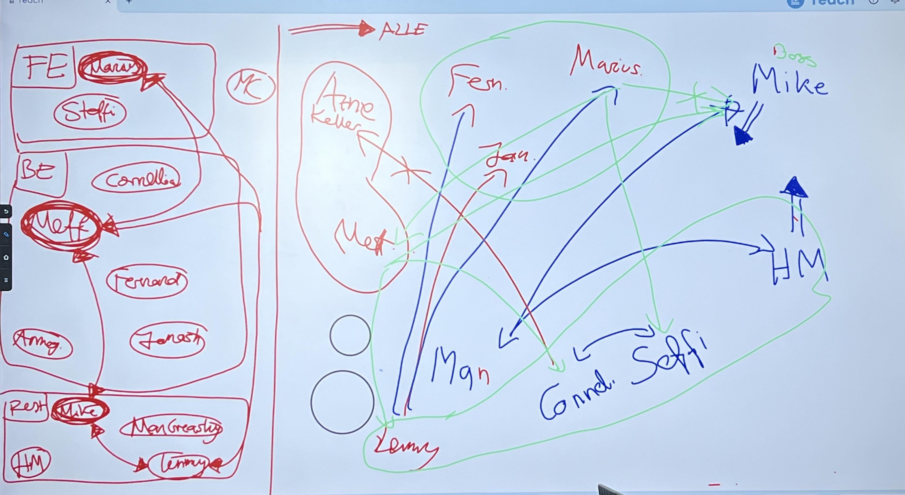

![[Pasted image 20260415104736.png]]

# Klappentext

Der erste Tag im neuen Job, du bist maximal nervös...
Wie sind die Kollegen, wie ist der Chef?
Bist du zu over- oder underdressed?
Wirst du dich schnell zurecht finden?

all das und mehr geht dir durch den Kopf bist du das Büro dann entlich betrittst und dir nur denkst.... "?!"

# Grundlegendes

 Ziel: Ein Spiel zu entwickeln, welches auf humoristische Art und Weise einem die Grundkonzepte von agilen Softwareentwicklungsprozessen näherbringt. Dies beinhaltet u.a. Sachen wie UML, Git, einfache Algorithmen, wie man Meetings strukturiert, SCRUM. Lerne anhand des Spiels die spezifischen Prozesse und warum diese eingesetzt werden und warum sie notwendig sind. Zeigen anhand von Beispielen warum es funktioniert, Vorher Nachher Geschichte. 
Motivation dahinter: Wir kennen schlechte Prozesse und wir wollen es besser machen und es spielerisch weitergeben 

## Zielgruppe

aktuelle Überlegung ist (durch Refactoring-Aufgabe angestoßen) Semester 3-4 eines durchschnitts-Informatikstudenten an der HTWK Leipzig
neue Überlegung ist es an 1-2 Semesterstudenten zu richten, die somit das erste Mal einen groben Überblick über Strukturen von Softwareentwicklung bekommen, erste Stufe des Lernens: Konfrontation mit dem Thema

### Grundriss

# Charaktere
### Main Charakter

Hauptcharakter: Nondeskriptiv, geschlechtsneutral (für späteres ändern), MC weiß es einfach besser und ändert deswegen alles ab
Arbeiten wir uns hoch von Praktikantenstelle aus oder sind wir spezifisch dafür da das wir dieses Office umstrukturieren?
 --> Aufgrund chaotischen OnBoardingprozess möglichkeit des "so tun als ob" wenn es darum geht Strukturen zu ändern dadurch das der Praktikant anfängt alle Strukturen umzuwerfen 

### Andere Charaktere
##### Teams / NPCs im Spiel
- zwei Teams
	- Frontend
		- 2 Personen 
			- `Marius`
			- Steffi
	- Backend - größer als Frontendteam
		- 5 Personen
			- Fernando
			- `Meff`
			- Janosch
			- Annegret
			- Cornelia
	- (Dev) Ops (Lemmy)
		- schläft im Serverraum
- Hausmeister (Glen Mathews)
- Sekretär (Man Greasley)
- `Chef` (Mike Gefängnis)
- Hauptcharakter

### Charaktereigenschaften

- **Chef**: Schreibt immer an alle, nicht an einzelne, liest nie die emails an ihn
- **Hausmeister**: Antwortet immer dem Chef (mit CC an alle)
- **Cornellia, Steffi** reden immer miteinander
- **Man** mit ihm redet niemand, obwohl er alles weiß
- **Annegret** redet mit niemanden, will nur ihr eigenes Ding machen

### Beziehungen zwischen Charakteren



Legende
- Kreis: sitzen zusammen
- Kreuz auf einfacher Linie: gescheiterte Kommunikation
- Doppel-Pfeil: geht an alle

Hintergedanke: Man will aus dem rechten ist-Zustand zum linken soll-Zustand kommen
-> soll der Spieler herausfinden


### Levelaufbau

(Resident Evil like, das man durch neue Items neue Bereiche freischaltet)
Anfangs sind Bereiche quasi durch "Dach" oder "Decke" ausgegraut, bzw ausgewandet, sodass man nicht anfangs komplett überfordert wird von dem gesamten Layout. Man schaltet im Storyverlauf, durch Quests oder durch simples reingehen frei, was für Bereiche man sehen kann (eventuell alles einmalige Events, potentiell immer nur der Bereich aktiv in welchem man sich befindet (Einstellungen eventueller Toggle um dazwischen zu switchen))

### Genre

1. Vorschlag: Isometrisch rumlaufen (birds eye view?) + Story + Rätsel (Stardew Valley Pokemon Pixel (Workadventure Hardwarelabor)) Pixelart, Menschen, (NPCs und es gibt deinen Charakter (erstmal keine Charaktererstellung))
2. Vorschlag: Walking Simulator (nur leichter Vorschlag)

### Plot

-> Hauptcharakter kommt ins Unternehmen, 1. Tag im Unternehmen, kriegt Zugangskarte, kriegt gesagt geh mal zum Chef und findet raus nichts geht, keiner ist Vorbereitet, kein Laptop, du bist Praktikant und kommst heute?
Verlauf: Es muss dazu kommen das der Hauptcharakter daran arbeitet selber arbeiten zu können (Equipment Schreibtisch Arbeitsplatz, andere Zugangsberechtigungen (Passwort, keine Programme (Stell dir mal vor die haben irgendwo alle Passwörter in einer Akte drin, du siehst alle Passwörter (Ähnlich wie LucasArts spiel ich hab Name vergessen wo man Bücher anklicken kann))))
Man kann selber nicht arbeiten, andere können aber auch nicht arbeiten, nichts ist Dokumentiert (-> UML) und Prozesse da kommen wir dann zu SCRUM, Spaghetticode
-> Vorgänger Plotpoint: Es läuft chaotisch weil der Vorgänger in Rente gegangen ist, Praktikant ist aufeinmal da, oh nein oh nein, er hat dann das Buch gefunden was ihn dazu anleitet diese Prozesse zu lösen. Man redet mit NPCs 

Was macht die Firma eigentlich?
1. Vorschlag: Man kriegts erst am Ende oder potentiell garnicht mit
2. Vorschlag: Macht Software für Kaffeemaschinen (aber die im Büro funktionieren alle nicht)
3. Vorschlag: Finanzsoftwarehersteller, dadurch weiß niemand (potentiell Pleite)


ALLES IST EIN ALBTRAUM, am Ende wachst du auf und musst in die Uni zur SCRUM Vorlesung


## Was wollen wir vermitteln?

### SCRUM / Agile Prozesse
siehe erste Quest

### UML
potentiell Weicker fragen für schlechte Beispiele die lustig sind

### Spaghetticode fixen
possibly mit Drag & Drop


## Featurelist

- Erstes Rätsel: Man redet mit allen Leuten, sammelt nebenbei eine Art Spinnennetz für wer mit wem für was redet wer für was zuständig ist und stellt am Ende fest: ist alles kacke, erstes Rätsel dann daraus zu entwickeln wer ist für was zuständig, wie könnte man strukturen vereinfachen, und besser klären  wer für was, Crossfunctional Teams bauen, 
Jeder sitzt am falschen Platz, nichts ist sortiert, dadurch die Kommunikationswege durcheinander
 - suchst Gegenstände (auch Informationen) die dir an anderer Stelle helfen, wie Laptop, wie Passwort, das Informationsbuch, da ist das Rätsel wo setzt man das dann ein. Man findet und muss finden wo es eingesetzt wird, man muss Anleitung im Buch freischalten indem man Rätsel findet? Man kann bestimte Dinge erst sehen, wenn man das Spinnennetz hat und entwirrt hat? Infos existieren schon im Buch aber man findet erst nach und nach raus wofür die da sind?
 Unvollständige Situation in der noch Gegenstände fehlen, man findet Abschnitt im Buch aber man weiß noch nicht wo man es anwenden kann, aaaa aber hier sind aufeinmal Klassendiagramme notwendig. 
 Rätsel sind eig alle Drag & Drop 
 Coding Rätsel? auch Drag & Drop oder Schieberätsel, wie löst man bestimmte Probleme (-> potentiell zu komplex)
 - Charaktersteuerung, Puzzle Schieberätsel

Dinge passieren nicht über einen Tag verteilt sondern über mehrere, Tagwechsel führt zu Office sauberer falls Rätsel vorher gelöst wurden

# Quests 
! Anne Anmerk.: So schön das alles ist und so gern ich das alles drin haben will, sollten wir diese Sachen vllt wirklich hinten anstellen und uns auf den Learning Bereich des Spiels fokussieren. Also wirklich erstmal an den Rätseln arbeiten und "das Herz" aufbauen und dann all den Fluff drumrumbasteln mit Kaffeemaschine, Geschirrspülmaschine, Chef bei Laune halten


Laptop hat nichts ausser das Hilfebuch :D 
Dokumentation -> Drag & Drop lässt Kacheln hin und herziehen
Mehrere Rätsel für unterschiedliche Typen, also mehr Typen

SCRUM mit zuerst vllt weil damit man merkt wer was wo machen muss, Leute reden nicht direkt miteinander und es ist nicht klar hierarisiert wer was macht, Besprechungstisch und leute werden neuzugewiesen

 
### Kaffeemaschine reparieren

### Laptop auftreiben

### Geschirrspülmaschine / Küche in Ordnung bringen

### Chef bei laune Halten

### Dokumentation

### Spagetthicode fixen / Refaktorie

Idee: NPCs machen ihr Ding, dadurch entstehen Aufgaben für den Spieler
1. Einführung
	- neues Layout wird entdeckt
	- 1 NPS leitet ein
	  "Schau mal mein toller Code"
		- 2-3 NPCs verweisen auf 'main' NPC

2. Eigentliche Aufgabe
	- Misual-Mudio Code-Umgebung (angelehnt an VSC)
		- bspw. für Refactoring-Aufgabe: ganz viele else if anweisungen

```ts
if (n==1) return false;
else if (n==2) return true;
else if (n==3) return false;
...
```
- Ideen
	- Fragen fliegen ganz schnell auf einen zu, man muss entscheiden ob man sich dafür oder dagegen entscheidet
	- Man refactored Code mit Drag and Drop Prinzip
	- man markiert Zeilen Code in einem Programm, bei denen man denkt dass es "falscher" Code ist. Gedankenwolke zum überprüfen
- ```Grundidee, dass man Konzepte abstrakt vermittelt```
	- d.h. Lesbarkeit, Übersichtlichkeit, Redundanzen,... (was auf Refactoring zutrifft) über Beispiele vermitteln
3. Smalltalk nach abgeschlossener Aufgabe, nach hause gehen (Ende vom Tag)
	- man gibt sich als Chef aus und schreibt Mails wie "so machen wir das jetzt"


### Irgendwann feststellen das du gar nicht weißt was die Firma eigentlich macht und das Rausfinden

# Erstellung der Tagesabläufe

| Tag | Task                            | Anmerkungen                                          |
| --- | ------------------------------- | ---------------------------------------------------- |
| 0   | Laptop finden                   | Kennenlernen <- Sammeln von Informationen über Firma |
| 1   | Einführung sinnvoller Struktur  |                                                      |
| 2   | UML                             |                                                      |
| 3   | Refactoring                     |                                                      |
| 4   | 🎉 Beförderung / Festanstellung | `Das Büro räumt sich über die Tage hinweg auf`       |

- Technische Klärung wie man Tage in GoDot umsetzen kann 
	- über globale Variable anhand der sich die Notes anpassen
	- (if tag == 0 do xy else z)
- NPCs, Personen die man sieht, Raum etc. sind abhängig vom aktuellen Tag

# Konkreter Tagesablauf/Spielablauf - ausgenommen mögliche Nebenquests, nur Hauptstory/"der rote Faden"

Von Anfang an da:
- Notizbuch welches am rechten Rand Reiter hat zwischen denen man hin und her wechseln kann um verschiedene Hinweise zu begutachten. 
- Wird nach und nach gefüllt mit wichtigen Infos, dem Spinnennetz, dem Laufzettel, Quests etc.
##### ==Tag 0== (Montag) -> Ankommen

Dialog (Blackscreen Chatbox unten)
--- Firma xy ist die bestbewertetste Firma im Landkreis ...
	- Firma hat Preise gewonnen etc.
- Man kommt in die Firma
	- Rezeption begrüßt den Spieler freudenstrahlend

Handlung
- man erhält Chip & Zugangsdaten fürs Büro
	- Idee: man erhält auf einem Blatt Papier die Email und Passwort für die eigenen Account-Zugangsdaten - der Plot: man ist dann auf einmal als Chef eingeloggt, da er aus versehen seine Credentials aufgeschrieben hat
- Laufliste (was man alles an Material hat), Dokument das Onboarding-Prozess begleitet
- Aufgabe: Rede mit Chef (keine Info wo/wer das ist)
	- mit NPCs reden
	- Welt erkunden
	- Infos sammeln
- Erste ```Quest```: Laptop finden (implizit dadurch Chef finden)
- Weitere ```Quest```: mit allen NPCs unterhalten
- daraufhin wird man frei in das Büro entlassen
	- Möglichkeit mit allen NPCs zu reden, man fragt sich durch wer der Chef des ganzen ist und wird Passierschein A38 mäßig durchgeleitet, jeder ist ein bisschen chaotisch, Kommunikation ist nicht so die Stärke der NPCs
	- Der Spieler findet durch Dialoge heraus, dass NPCs alle durcheinander im Büro sitzen, nicht in Teams sortiert sind, nichtmal unbedingt Teams haben, jeder reported willkürlich seine Arbeit an irgendeine Person
	- während Dialogen werden bei Schlüssel-Sätzen stets automatisch Notizen im Notizblock angelegt 
		- "Ich muss heute noch mit Fernando reden um rauszufinden, welches Daily Passwort er gesetzt hat" - von einer Person die arbeitsmäßig nichts mit Fernando zutun haben sollte (bspw Man Greasly)
		- automatisches Pop Up, in welches die Verbindung von Man Greasly <-> Fernando eingezeichnet wird
		- durch diesen iterativen Prozess wird nach und nach der Zettel gefüllt, sodass er wie ein Spinnennetz aussieht (im weiteren auch als Spinnennetz bezeichnet)
		- stets anklickbar im Notizbuch
* Nachdem man mit allen NPCs einmal geredet hat, ist das Spinnennetz aufgefüllt sodass es am Dienstag gelöst werden kann
- angekommen beim Chef hat man Dialog in welchem man von ihm begrüßt wird und 

Dem Notizbuch wird hinzugefügt:
- Laufzettel
* Spinnennetz was sich stetig füllt
- Liste mit NPCs die man schon kennengelernt hat, auch evtl Auflistung der NPCs die noch fehlen

```In a Nutshell```
- Man bekommt ein Laufblatt
- da steht geh zum Chef
- Chef weiß nichts davon
- Chef sucht irgendwelche Dokumente
	- Blatt auf dem steht neuer Mitarbeiter etc. den man bekommt
- man erhält seinen Laptop

##### ==Tag 1== (Dienstag) -> Spinnennetz

- Erster Arbeitstag, MC kommt auf Arbeit und kriegt als Arbeitsplatz die sinnloseste Arbeitsplatzstelle zugewiesen, an welcher er im Team keinen Sinn macht. Daraufhin entsteht beim MC der Wunsch das Büro neu anzuordnen sodass Teams sinnvoll gestaltet sind und auch am richtigen Ort sitzen
- Aufgabe: Spinnennetz auflösen, wer mit wem interagiert, wo Schwierigkeiten sind, welche aufgaben von wem übernommen werden
- Am Dienstag fangen NPCs an, sich über bestehende Strukturen und ineffienz sich implizit zu beschweren 
	- Idee hierbei ist das NPCs sich in ihrer Welt ja nicht mit "besseren" Strukturen auskennen und sich einfach mit dem Status Quo hingeben, da sie es nicht besser kennen. 
	- Evtl. Kommentare a la "Ständig muss ich Fernando A sagen nur damit er leichte Änderungen macht und das dann an Meff weitergibt, welcher auch leichte Änderungen macht und dann kommt es an mich zurück. Aber jeden Tag merke ich, das diese Änderungen der beiden sich nur auscanceln gegenseitig."  
	- Lemmy will möglichst weit weg von allen anderen wegsitzen, da er es nicht aushält jeden Tag mit einem anderen Level als seine eigene Kompetenz konfrontiert zu werden
	- Bestehende Struktur besteht ua. aus individuellen Echtwelt Erfahrungen die das Team von Chaoffice gesammelt hat, sie überspitzt aufschreibt und in das Format des Spieles umsetzt
- MC bekommt nach erstem Dialog den eigenen Gedanken "Das könnte man bestimmt verbessern..."
	- Danach blinkender Leuchthinweis auf das Notizbuch, im Notizbuch weiterer blinkender Hinweis auf die Seite mit dem Spinnennetzrätsel
- In Spinnennetzrtätsel dann Möglichkeit, Namen per Drag & Drop zu ziehen und drei-vier eigene Departments zu schaffen & zu benennen
	- Benennungsideen entweder selber benennen oder aus Vorschlägen auswählen (Bspw Frontend, Backend, DevOps, Rest zb), bei Vorschlägen dann Erklärungen warum diese eine gute Idee sind. 
	- Auch Möglichkeit die Teams (ausser Man Greasly, Mike Gefängnis, Glen Matthews) bestimmten Räumen zuzuordnen 
		- Entscheidung hat nur bedingt Einfluss auf das Spiel, NPCs ordnen sich im Raum, an den Arbeitsplätzen, automatisch an, je nach Vorauswahl, und wohnen dann für den Rest des Spiels da
		- Constraints der Einordnung sind Platzgröße im Büro (3 Teams, eines links oben, eines rechts unten, eins wohl einfach nur Lemmy, rechts in der Mitte). Vorher nicht
		- Richtigkeit der Einordnung nur vage bewertet - Mehrere große Konflikte sollten gelöst werden, viele kleine Konflikte sind nur optional zum lösen für die optimale Lösung, aber das wird nicht bewertet. Nur Aussage, dass dies die perfekte Lösung ist wird gelobt
		- Erinnert an Spiele wie "is this seat taken", wo man Menschen nach ihren Vorlieben platzieren muss - allerdings abgespeckter, da sich die NPCs ihren Platz innerhalb der Gruppen selber aufteilen
	- *Vermittelt das Konzept einer sinnvollen Aufteilung in Strukturen durch eigenes rumexperimentieren und individuellem NPC Feedback, wie sie miteinander interagieren sollen - vgl Konstruktivismus, individueller/sozialer Ansatz*
		 - *es ist konstruierter Konstruktivismus indem man ein künstlicher Teil des erstellten Büros wird und dann mit den dort bestehenden Individuen, die Teile des Systems, interagiert, sich immersiv in diese Welt einordnet und interaktiv die Welt verändert, dadurch das man seine fellow Individuen unterstützt in der Lösungsfindung.*
		 - *Man erschafft neue Strukturen, indem man den NPCs aus ihren bisherigen Strukturen hinaushilft - die neue Struktur kann ohne die vorher vorhandenen "negativ" Strukturen, welche bereits von den NPCs vorgegeben wird, nicht entstanden sein, da sie bereits in der konstruierten Welt für sie unzufriedene Erfahrungen gehabt haben.*
		 - *Durch neue Strukturen kann der MC wieder mit den NPCs reden und so herausfinden, ob die neue Position der richtige Weg ist, um das Team aufzuteilen - Der MC konstruiert auf Basis des Informationsaustausch der NPCs und dem MC eine neue Realität, die den NPCs zugute kommt - positives Feedback der NPCs befeuert somit den Spieler, die optimale Lösung zu finden*
		 - *direkt wird die Anwendung dieser Struktur angezeigt, denn NPCs können folglich untereinander besser Informationen austauschen, da sie im selben Raum sitzen.* 
	- Benachrichtigungsketten der NPCs werden implizit durch vorgegebene Dialoge vereinfacht -> "Was hältst du davon die Änderungen selber zu machen und dann direkt abzugeben" bzw "Was hältst du davon, die Änderungen nur an diese Person weiterzugeben?" etc
	- *Konstruktion und Rekonstruktion somit umgesetzt, Dekonstruktion findet dann im außen statt, wenn die Zielgruppe des Lernspiels aktiv mit ähnlichen Situationen konfrontiert wird*
- Nach erfolgreichen Abschließen des Rätsels sind alle NPCs glücklich und der MC kriegt die Option nachhause zu gehen, darf sich aber durchaus weiter umschauen für weitere optionale Nebenquests, die dem Silliness und Chaos Vibes des Büros beitragen
##### ==Tag 2== (Mittwoch) -> UML
- Beim Betreten des Büros am Mittwoch stellt der Spieler fest, dass das Büro wesentlich aufgeräumter, wenn auch nicht komplett sauber, ist als vorher. 
- Jetzt, da die Hürde des unausgeglichenen Teams beseitigt ist, stellt sich die Frage, wie der neue Code der Firma im Groben strukturiert wird. 
	- Anlehnend an das Konzept eines Lückentextes (aber komplexer)
- Klassendiagramm: Aufzeigen der richtigen Syntax durch interaktives Wort & Bild
	- Grob vorgegebenem Klassendiagram fehlen wichtige Inhalte um ein schlüssiges Bild zu produzieren
	- Beziehungskardinalitäten müssen manuell gesetzt werden
		- direkte Anzeige auf einer Bildschirmseite, welche Auswirkungen diese Zahlen haben
		- Plantage hat Baum hat Äpfel 
		- Eintragen der Kardinalitäten rendert entsprechend der übergebenen Werte eine mini Plantage an der man sehen kann, welchen Einfluss die Werte haben
			- 50 Äpfel für genau einen Baum, ein einzelner Apfel pro Baum, 50 Plantagen, jede Plantage hat einen Baum mit 0 Äpfeln - usw
		- Beispiel eventuell anpassen auf etwas Office sinnvolleres - oder nicht wenn der Ansatz des "wir wissen auch nicht was die Firma macht" verfolgt wird
		- dieser Teil mehr Simulator als Abfrage der Richtigkeit, da Kardinalitäten ein Auslegungsspaß sind
	- setzen der Pfeile & Richtungen um richtige Beziehungen darzustellen
		- hier schon eher Wert auf Richtig/Falsch, da ein Apfel nicht von 50 Bäumen fallen kann
			- wäre aber lustig
				- wäre vorallem eine coole Spielidee so eine Informatikersuperkraft zu haben mit der man die Welt als Klassendiagramm abstrahiert und dann dort genau diese Sachen ändert um Probleme zu lösen/Probleme zu schaffen
					- so many ideas, so little time
		- bei Arten der Pfeile Textsnippets haben die sich dynamisch ändern
			- "Diese Hose kann ohne Hostentaschen nicht existieren" vs "Diese Hosentasche kann ohne Hose nicht existieren"
			- man sieht live den Impact der Pfeile in einer wunderschön farblich kodierten Textbox
			- auch als Bild möglich aber das ist komplexe Logik + viele Assets
		- *hiermit starker Fokus Konstruktivismus (hauptsächlich Konstruktion), da individueller Entscheidungsprozess und individuelles Ausprobieren die eigene passende Welt dieses Büros schafft und wie die gedachte Welt dort weiterfunktionieren wird*
			- *das UML Diagramm ist hier analog zu dem menschlichen Konstrukt der Wirklichkeit welches sich in einem menschlichen Konstrukt der Wirklichkeit (Das Büro) befindet.*
			- *Vergangenes Wissen ist alles was der Spieler bereits weiß über das Leben, vgl. das Konzept Apfelplantage + und simple mathematische Konzepte von Vervielfältigung und es wird zusammengesetzt mit dem neuen Wissen wie man diese beiden Konzepte kombiniert um Diagramme für Softwareentwicklung zu schaffen*
			- *Es entsteht ein taugliches Konzept für das Umfeld im Spiel, das Büro und die Firma, der Spieler bewertet nutzen selber*
				- *selbst wenn nur alberne Sachen gemacht wurden um zu schauen was passiert und dies dann eingeloggt wird, verlässt der Spieler das Minispiel mit dem Gedanken, dass das nicht richtig ist -> Lernziel erreicht, da der Spieler weiß was falsch aussieht - das kritische Hinterfragen hat stattgefunden*
			- *die Vorraussetzung zur Konstruktion sind hier erfüllt: Selbstbestimmung wird voll ausgeführt, indem der Spieler jeden Wert abgeben kann, nachdem ausführlich rumexperimentiert wurde und Selbstwert basierend auf dem Spieler bedingt auch erfüllt - wer bis zu diesem Zeitpunkt spielt ohne aufzuhören, der will ja auch irgendwo am Lernprozess teilhabe leisten*
			- *Rekonstruktion TBE (to bei eingefügt)*
			- *Dekonstruktion passiert im aussen, da der Spieler nun die Mittel besitzt, das gelernte Wissen aktiv in den Lehrveranstaltungen Softwaretechnik, Softwareprojekt umzusetzen - dort neues ausseinandersetzen mit den Lehrinhalten*
- Sequenzdiagramm: Aufzeigen der richtigen Syntax durch Wasserlaufspiel
	- Ein Sequenzdiagramm mit vielen Fehlstellen
	- MC zeigt mit Ablauflinie, die einem Wasserstrom gleicht, wo das Sequenzdiagramm schief läuft, ab wo der Strom blockiert wird
	- dann Möglichkeit verschiedene Sequenzdiagramm Snippets per Drag & Drop einzusetzen
		- Diese sind in einem "drehendem" Anzeigesystem drin welches <- und -> zum durchcyclen von möglichen Puzzleteilen hat
		- Simples Puzzle in welchem man diese Snippets an vorgefertigte Stellen einsnappen lassen kann (wie in einem Puzzle-Puzzle) 
	- Überprüfen Button welcher dann die Linie nachzeichnet (den Wasserstrom anzeigt) um zu schauen ob alle Bereiche erreicht werden und ein sinnvoller Ablauf zustande kommt
		- Unendlich viele Möglichkeiten diesen zu nutzen
		- bei if/else sachen geht die hervorgehobene Linie von beiden Zweigen gleichzeitig aus und läuft diese ab
- das sind die beiden wichtigsten länger wichtigen UML Diagrammarten, evtl noch Aktivitätsdiagramm oder Anwendungsfalldiagramm
	- Anwendungsfalldiagramm könnte man ans Spinnennetz anknüpfen und zuerst klären welches Team jetzt nochmal was macht und danach Klassendiagramm und danach Sequenzdiagrammsspiele machen (Vom höheren Level zum granulareren Level)


##### ==Tag 3== (Donnerstag) -> Refactoring (unser MVP)
- Beim Betreten des Büros am Donnerstag stellt der Spieler fest, dass das Büro noch aufgeräumter ist als am Mittwoch, aber es gibt immernoch Verbesserungspotential
- Heute ist Review Tag, jeder NPC welcher mit am Code der Firma gearbeitet hat, reviewed heute Code eines anderen NPCs
	- Man geht zu allen Code-NPCs hin nach einander und kann jeweils ein kleines Refactoring Rätsel lösen, welche wie folglt aufgebaut sind
		- Einleitender Dialog was das Thema ist, dass der NPC nicht weiterkommt und gerne der MC mal drüber schauen sollte. 
		- Das Rätsel wird betreten, in der Mitte des Bildschirmes befindet sich das Coderätsel zum begutachten 
		- Im Dialogfensterbereich befindet sich ein Erklärdialog wie das Spiel funktioniert
		- Der Spieler hat nun die Möglichkeit mehrere Flaggen an Codestellen zu setzen, wo sich Code Smells befinden
			- "Der Code riecht aber schlecht..."
			- Unterschiedliche Warnsignale schlechtem Codes - bei Variablennamen bspw offensichtlich schlechte Namen wie Flusspferd 
			- Mit einer vorgegebenen Box wird gecheckt ob jede Flagge nur in einem Bereich ist und ob alle Bereiche abgedeckt sind
			- Falls dies nicht der Fall ist kriegt man die Option ob man selber weitersuchen will oder ob der MC das einfach kurz für einen Aufdecken soll
				- Den Spieler nicht verzweifelt in einem State des "Suppe an die Wand werfen und schauen was Klebenbleibt" halten
				- nur als kleine Einstiegsmahlzeit gedacht um auf das eigentliche Rätsel hinzuarbeiten
			- Danach die Möglichkeit die einzelnen Flaggen anzuklicken und abzuarbeiten
			- Mit dem Klick auf eine Flagge wird verschiebt sich das Codesnippet auf die linke Bildschirmseite und auf der rechten Seite erscheinen untereinander drei Alternativvorschläge dafür, wie diese Stelle im Code aussehen könnte
			- Stets unten eine Dialogbox die Hinweise auf den Spielverlauf gibt -> "Welche dieser Ideen könnte wohl passen?"
			- Beim klicken auf eine Idee wird in der Dialogbox ein Gedanke des Main Charakters erscheinen, der ein für und wieder widerspiegeln soll, wie weit der ausgewählte Codesnippet passt
				- Dabei entweder die Verteilung von 1x richtige Option, 2x falsche Option oder 2x richtige Option und 1x falsche Option
				- Wenn man sich entschieden hat für eine Option, loggt man sie mit einem Klickfeld im Dialogfenster ein, dann wird im Falle einer der richtigen Option diese übernommen und eine Erklärung wird gegeben, warum das eine gute Option war!
				- Entscheidet man sich für die falsche Option, greift der MC ein und erklärt einem warum das keine gute Idee wäre, das zu verwenden, dann wieder zurück und man kann eine neue Option auswählen
				- danach wandert das Codesnippet mit dem geänderten Code zurück in die Mitte und die Flagge ändert sich zu grün
				- hiernach kann man weitere Flaggen anklicken, bis man alle durch hat
	- Das gleiche Spiel für jeden NPC der Code hat, danach ist die Tagesaufgabe abgeschlossen und man kann wieder nachhause gehen

##### ==Tag 4== (Freitag) -> Ende & Verabschiedung
- Beim Betreten des Büros am Freitag stellt der Spieler fest, dass das Büro komplett aufgeräumt ist und so eine optische Ruhe eingekehrt ist. NPCs arbeiten normal, es muss kein metaphorisches Feuer gebändigt werden und der Büro Alltag geht eines ungewohnt neuen Ganges. Gelgenheit an den Spieler sich von allen NPCs zu verabschieden, jeder NPC hat Dialog welcher in eine Richtung von "Es ist alles so viel besser seit du da bist" angepasst auf die jeweilige Persönlichkeit des NPCs und wie sehr der Spieler dem jeweiligen NPC geholfen hat
	- Bei NPCs mit viel unterlassener Hilfeleistung nur Kommentar a la "Alles ist ein bisschen anders, seit du hier bist. Ich verstehe noch nicht ganz, warum ich jetzt hier sitze und was PersonX neben mir soll, aber es wird bestimmt Sinn ergeben"
- Man darf rumlaufen und mit allen noch reden, sobald man zu Mike Gefängnis geht und mit ihm redet, wird der Finale Dialog eingeleitet, welcher dazu führt, das der MC befördert wird, permanent eingestellt wird, seine herausragende Leistung gelobt wird 
	 - Alternatividee: Mike Gefängnis hat dem nichtsmehr hinzuzufügen, geht einfach spontan in Rente oder entscheidet sich unter dem MC zu arbeiten, MC wird neuer Chef des Büros
		 - Roll Credits
- Alternatividee/Idee obendrauf: All das und es findet im Sinne von SCRUM eine Retro statt, bei der die NPCs viel dialoglastigen Input über den Verlauf des Spiels/der Woche geben können
	- Kontra: Dialoglastig, nicht TikTok Brain genug - wenn so dann muss der Dialog wirklich reinballern so wie in Disco Elysium
	- Wäre auch süß das über alles drüberlegen zu können, also die ersten Tage sind Sprintplannung und Dailies mit drin, da müsste alles wieder aber banger Dialog sein, keiner will ein Tutorial HowToScrum Dialog lesen

___
##### Anmerkungen
Tag 1 potentiell zu wenig Inhalt, unausgeglichen vgln mit Tag 2 & 3
Tag 0, 4 sollen bewusst klein gehalten werden um Glockkurve zu haben in den Inhalten

___

## Nebenquest Ideen (größtenteils unausgearbeitet)
- Man versucht durch Dialogbäume noch nebenbei verschiedene Streitgespräche zu lösen von Interpersonellen Konflikten zwischen der NPCs
	 - dadurch Vertiefen der Bindung zwischen Spieler und NPC -> mehr incentive diesen bei den Lernspielen zu helfen
- Kaffemaschine reparieren 
	- wie in jedem guten Büro ist die Kaffeemaschine permanent kaputt